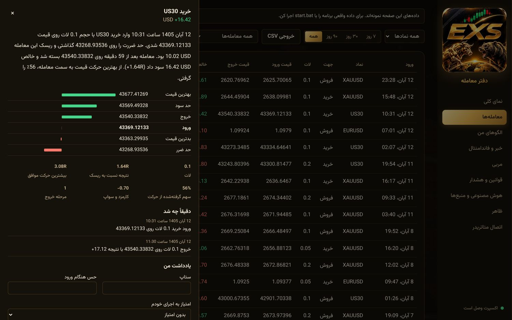
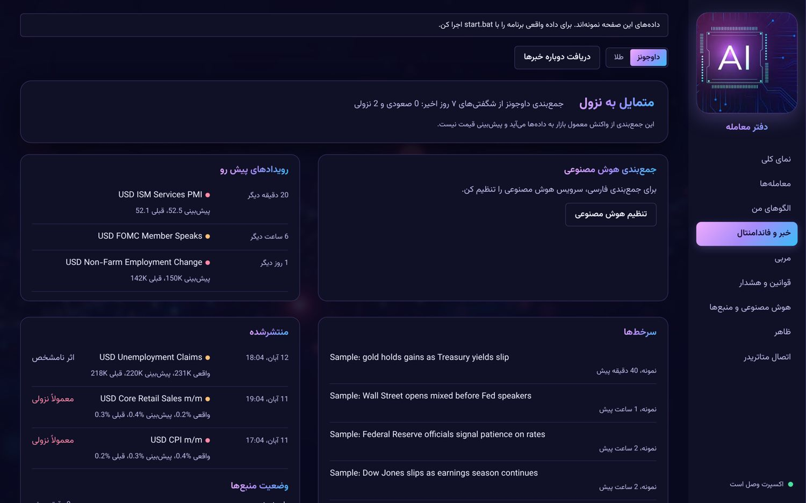
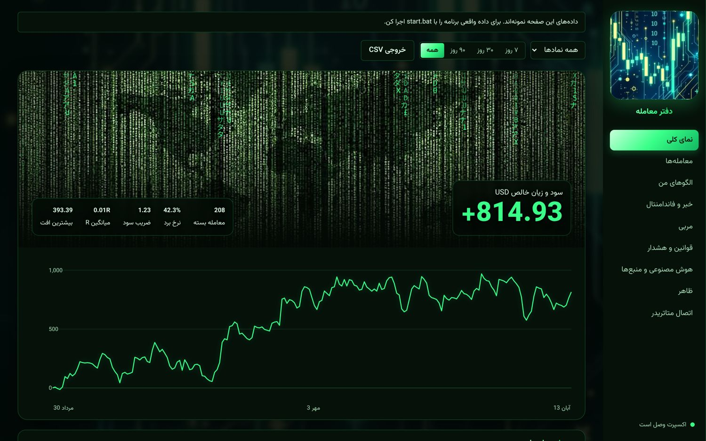
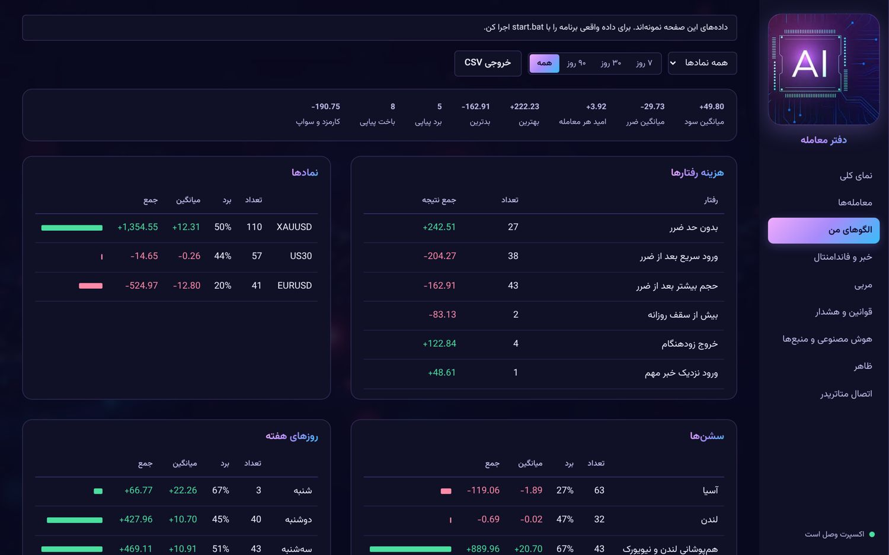
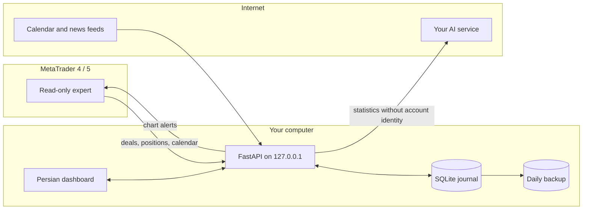

<p align="center"></p>

<h1 align="center">EXS Trade Journal</h1>

<p align="center">
  <strong>A private, local-first trading journal for MetaTrader that turns every trade into evidence.</strong><br>
  Automatic capture, behaviour analytics, live fundamentals and an AI coach, in a Persian dashboard.
</p>

<p align="center">
  
  
  
  
  
  
</p>

<p align="center"><a href="README.fa.md">راهنمای فارسی</a> · <a href="docs/PORTFOLIO.md">Project case study</a></p>

---

## Why it exists

Most traders can recall their best trades but not their real patterns. Spreadsheet journals get abandoned, and hosted journals ask you to hand your trading history to someone else.

This project records every trade automatically, keeps the data on your own computer, and answers one question with numbers: **what am I actually doing, and what is it costing me?**

<p align="center"></p>
<p align="center"><sub>All screenshots use the built-in sample data.</sub></p>

## What it does

| | |
|---|---|
| **Automatic capture** | A read-only MT4/MT5 expert sends deals, open positions and stop or target changes. |
| **A story for every trade** | Entry, risk, exit, R multiple, best and worst price, and a timeline written in Persian. |
| **Behaviour analytics** | Detects revenge entries, size increases after losses, missing stops, widened stops, early exits, overtrading and entries around high-impact news, and shows what each one cost. |
| **Fundamentals by market** | Choose Dow, Nasdaq, gold, EUR/USD, GBP/USD or oil. See upcoming events, released figures against forecast, the usual reaction and relevant headlines. |
| **AI coach** | Reads your statistics, recent trades, notes and its own previous report, then tracks whether you are improving. |
| **Discipline on the chart** | Daily loss limit, trade limit, loss streak, cooldown, missing stop and pre-news warnings appear in MetaTrader. |
| **Personal look** | Eight themes, including EXS, Matrix and AI, plus custom accent, density and text size. |
| **Runs itself** | Desktop shortcut, start after login, updates from GitHub and daily backups. |

<table>
  <tr>
    <td></td>
    <td></td>
  </tr>
  <tr>
    <td align="center"><sub>Every trade explained</sub></td>
    <td align="center"><sub>Fundamentals, by market</sub></td>
  </tr>
  <tr>
    <td></td>
    <td></td>
  </tr>
  <tr>
    <td align="center"><sub>Matrix theme</sub></td>
    <td align="center"><sub>Patterns by symbol, session and weekday</sub></td>
  </tr>
</table>

## How it works



**Design decisions**

- **Trades are derived, not stored.** Raw deals are the source of truth, so a better metric recalculates all history.
- **Risk comes from the trade itself.** Money per price unit is taken from realised profit, so R multiples need no tick-value tables.
- **Broker time is normalised.** Deals are converted from each broker's server time to UTC on arrival.
- **One expert source, two platforms.** The same file builds as `.mq4` and `.mq5`.
- **A failing source stays isolated.** Each feed reports its own status and never stops the others.

## Privacy and safety

- The server listens only on `127.0.0.1`, requires a token from the expert and rejects foreign hosts.
- The expert contains no order functions. It cannot open, change or close a trade.
- Your journal, token and API key are never committed.
- The AI service receives statistics, recent trades and your notes, but no account number, name or broker.
- Backups exclude the API key.

## Quick start

Requires Python 3.10 or newer.

```bash
git clone https://github.com/ebixs/Trade_Journal_Expert_Forex.git
cd Trade_Journal_Expert_Forex
```

| | macOS | Windows |
|---|---|---|
| Explore with sample data | `bash start-demo.command` | `start-demo.bat` |
| Run for real | `bash start.command` | `start.bat` |
| Install shortcut and login start | `bash install-shortcut.command` | `install-shortcut.bat` |

Then open <http://127.0.0.1:8765>. The **اتصال متاتریدر** page walks through connecting MetaTrader.

## Project layout

```text
ea/                 MT4 and MT5 expert, one shared source
app/ingest.py       Applies each sync, detects stop and target changes
app/analytics.py    Trades, statistics, behaviour flags, insights, alerts
app/markets.py      Market rules, event reactions, rule-based briefs
app/feeds.py        Calendar and news collection
app/ai.py           Coach and briefs through a configurable service
app/backup.py       Daily backups without the API key
app/static/         Dashboard and themes
launcher.py         Desktop shortcut: update, start, open
tests/              Automated tests
```

```bash
pip install -r requirements-dev.txt
pytest
```

## Current status

| Area | Status |
|---|---|
| macOS with MT5 on a demo account | Working: compiled, connected, live news and calendar |
| Server, analytics, backups, launcher logic | Covered by 59 automated tests |
| Windows launcher and MT4 build | Written, not yet run on real systems |
| Real AI service | Tested against a local stand-in so far |
| Netting accounts | Basic support; position reversals may not split exactly |

## Disclaimer

This is a personal journaling and education tool, not financial advice. Directions shown for news events describe common market reactions and are not forecasts. Trading carries a real risk of loss. Forex Factory, CNN, MetaTrader and other names belong to their owners, and this project is not affiliated with them.
